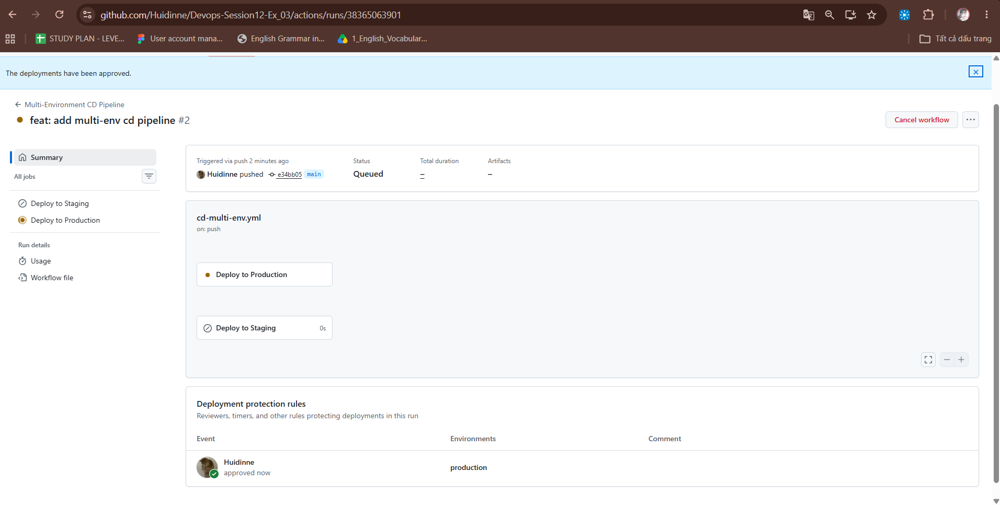
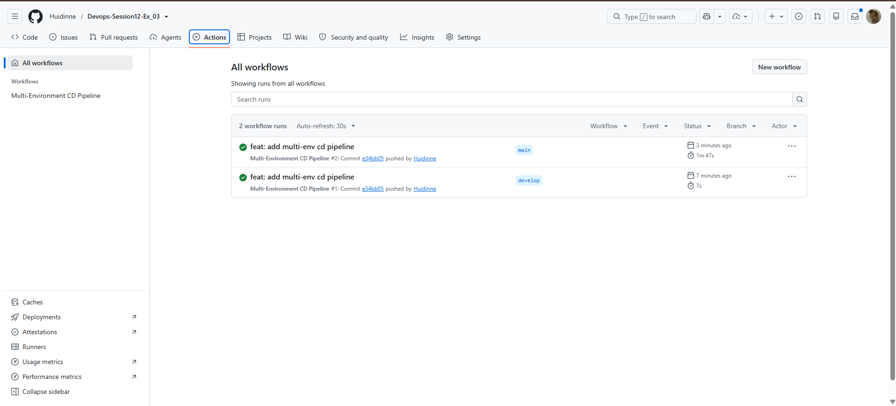

# Bài 3: Tách Biệt Luồng CI/CD Đa Môi Trường (Staging & Production) với GitHub Environments

## 1. Giới thiệu & Mục tiêu
- **Quản lý đa môi trường**: Phân tách môi trường triển khai **Staging** và **Production** độc lập.
- **Environment Protection Rules**: Thiết lập cơ chế kiểm soát an toàn, bắt buộc **phê duyệt thủ công (Manual Approval)** trước khi triển khai lên **Production**.

---

## 2. Các bước thực hiện chi tiết

### Bước 1: Cấu hình Environments trên GitHub
1. Mở Repository trên GitHub.
2. Đi tới **Settings** -> Chọn mục **Environments** (nằm ở thanh menu bên trái).
3. **Tạo môi trường `staging`**:
   - Bấm nút **New environment**.
   - Nhập tên: `staging` -> Bấm **Configure environment**.
   - Môi trường `staging` không cần bật Reviewers (hoặc để mặc định).
4. **Tạo môi trường `production`**:
   - Bấm **New environment**.
   - Nhập tên: `production` -> Bấm **Configure environment**.
   - Trong mục **Deployment protection rules**:
     - Tích chọn **Required reviewers**.
     - Tìm kiếm và chọn username GitHub cá nhân của bạn.
     - Bấm **Save protection rules**.

---

### Bước 2: Tạo tệp kịch bản Workflow
Tệp kịch bản được lưu tại: `.github/workflows/cd-multi-env.yml` với nội dung định nghĩa 2 Job:
- `deploy-staging`: Liên kết với `environment: staging`, kích hoạt khi đẩy mã lên nhánh `develop`.
- `deploy-prod`: Liên kết với `environment: production`, kích hoạt khi đẩy mã lên nhánh `main`.

---

### Bước 3: Kiểm tra luồng CI/CD

#### Test 1: Triển khai lên Staging (Nhánh `develop`)
1. Tạo và chuyển sang nhánh `develop`:
   ```bash
   git checkout -b develop
   git add .
   git commit -m "feat: setup multi-environment workflow"
   git push origin develop
   ```
2. Vào tab **Actions** trên GitHub:
   - Job `deploy-staging` tự động chạy và hoàn thành (tích xanh) mà không cần phê duyệt.

#### Test 2: Triển khai lên Production (Nhánh `main`)
1. Chuyển về nhánh `main` và merge/push:
   ```bash
   git checkout main
   git merge develop
   git push origin main
   ```
2. Vào tab **Actions** trên GitHub:
   - Workflow chạy và **dừng lại ở trạng thái**: `Waiting for review` (yêu cầu phê duyệt).
   - Có nút **Review deployments**.
3. **Phê duyệt:**
   - Bấm **Review deployments**.
   - Tích chọn môi trường `production` (có thể nhập ghi chú nếu muốn).
   - Bấm **Approve and deploy**.
   - Job `deploy-prod` bắt đầu chạy và kết thúc với tích xanh.

---

## 3. Sản phẩm nộp bài
1. Tệp kịch bản: [cd-multi-env.yml](file:///c:/Users/longl/Desktop/DevOps/Session12/Ex_03/.github/workflows/cd-multi-env.yml)
2. Ảnh chụp màn hình:
   - Cửa sổ pop-up **Review deployments** 
   

   - Màn hình sau khi hoàn tất deployment lên Production thành công (tích xanh).
   

